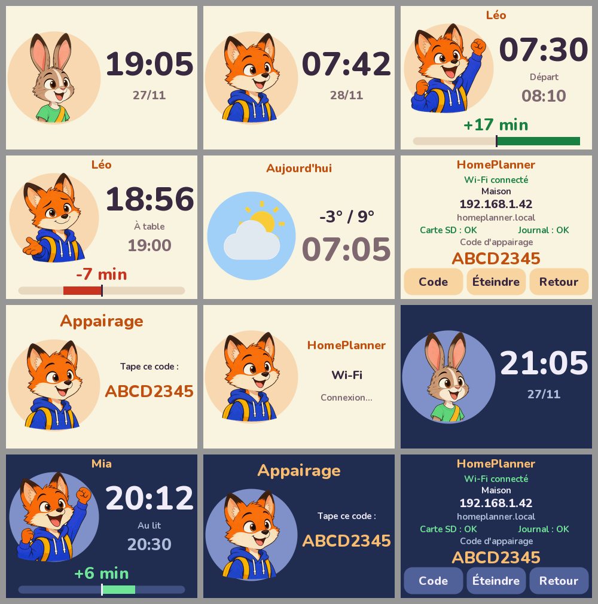

# Home central firmware (0.8.0 prototype)

One common core (`src/`) and one folder per board (`boards/<board>/`):

| Board (PlatformIO env) | Screen | Input | Web flasher |
|---|---|---|---|
| `waveshare-c6` — Waveshare ESP32-C6-LCD-1.47 | 172×320 portrait, SPI | BOOT button | `flash/` (menu « Appareil ») |
| `lilygo-t-hmi` — LilyGo T-HMI (ESP32-S3) | 320×240 landscape, 8-bit parallel | touch + BOOT button | `flash/` (menu « Appareil ») |

Status: the C6 is in use; **the T-HMI build compiles but has never run on the board.**

Build: `pio run -d platform/central -e <env>`. Screen tests on a PC: `tests/run_screen_tests.sh <ArduinoJson.h folder> [image folder]`.

## Adding a board

1. `boards/<name>/board_config.h`: `HP_BOARD_ID`, `HP_BOARD_NAME`, `LCD_W`, `LCD_H`, `HP_HAS_TOUCH`, `HP_PIN_BUTTON`, `SD_MOUNT` and the pins.
2. `boards/<name>/board.cpp`: the functions of `src/board.h` plus `lcdBlit` (`src/draw.h`).
3. `boards/<name>/partitions.csv` and an `[env:…]` in `platformio.ini`; add it to `.github/workflows/central.yml` and `tools/build_site.sh`.

The core picks the layout from the screen shape (`screen.cpp` portrait, `screen_wide.cpp` landscape). Both assume at least 172×320 or 320×240; another size needs a layout check with the screen tests.

## LilyGo T-HMI

Pins and display settings come from the [vendor repository](https://github.com/Xinyuan-LilyGO/T-HMI). Touch: tap the screen for the information page, which has « Code » (show the pairing code), « Éteindre » (screen off, tap to wake) and « Retour ». A small blue dot marks where the touch was read and the serial console prints raw values; if the dot is far from the finger, adjust `TOUCH_RAW*` in `board_config.h`. If the picture is upside down, set `LCD_MADCTL` to `0x60` (and swap the touch bounds).

Run **one central at a time** on the network: both answer to `homeplanner.local`.

## Web flasher

The Pages site serves one flash page, `flash/`, with a device menu fed by `web/flash/devices.json` (add a line there and in `tools/build_site.sh` for a new board): install or update from Chrome/Edge on a computer, no PlatformIO needed (`tools/build_site.sh`). Leave "Erase device" unchecked when updating.

## First boot / Wi-Fi setup

The firmware initializes the display first, then attempts the saved Wi-Fi networks. If none are configured or reachable, it starts a setup access point:

- SSID: `HomePlanner-XXXX` (suffix derived from the board MAC)
- Prototype password: `homeplan1`
- Portal: `http://192.168.4.1/` (also `http://192.168.4.1/_cfg`)

Connect a phone or PC to that network, enter the home Wi-Fi SSID and password, then save. The device stores up to five networks in NVS and restarts. The setup AP password is currently a shared prototype default; this must be made configurable before wider deployment.

The screen goes to sleep after 15 minutes without activity (button, touch, data received from a phone or the watch, pairing); a sync that changes nothing does not count. It stays on during routines (as defined above) and while Wi-Fi setup or storage needs attention. Any activity wakes it; a screen switched off by hand stays off until pressed.

BOOT button: short press shows the information page for 30 s; hold 2 s to switch the screen off or on; hold 5 s to clear saved Wi-Fi settings and restart into setup mode. Serial monitor is 115200 baud; `s` prints status, `compact` compacts the journal now, `x` clears Wi-Fi settings, and `ota-token <secret>` stores the OTA token in NVS.

If the Wi-Fi link drops, the device waits 30 seconds before opening the setup access point. While nobody is connected to that access point, saved networks are retried every 2 minutes.

## Display and recovery behavior

The display is initialized before SD mounting. It shows boot progress, then a resting screen with the mascots and the time (NTP). The information page (Wi-Fi/IP, SD, journal, pairing key) appears on BOOT, and stays on screen while Wi-Fi setup is needed or storage fails. While resting, the clock alternates with today's weather icon (20 s / 5 s) once the app has chosen a town: the central asks Open-Meteo hourly with the rounded position (HTTPS, certificate not verified). From one hour before a routine deadline, or from the first checked step, until 15 minutes after it, each child's routine is shown in turn with a schedule gauge and a reacting mascot, using the same rules as the watch (`hp_core`). Colours follow the time (`gfx.h`): a light day theme, and from 20:00 to 7:00 a soft blue night theme with a dimmer backlight. Bitmaps (with transparency) are generated by `tools/gen_images.py`, the smoothed [Nunito](tools/NUNITO-LICENSE.txt) fonts by `tools/gen_fonts.py`. On the C6 the screen and SD share SPI2, matching the Waveshare sd-server board implementation; the T-HMI uses SD/MMC (1 bit).

Missing or damaged SD/journal storage no longer prevents Wi-Fi setup, HTTP diagnostics, or the status screen from starting. The firmware never formats the microSD card automatically.

## API

- `GET /api/v1/health` (public)
- `POST /api/v1/pairing/request` (no token; opens a 60 s pairing window: screens show the household code, and a short press on BOOT approves)
- `POST /api/v1/pairing/claim` (no token; `{"code","name"}` with the household code, or `{"request_id","name"}` after the button press, `202` until pressed; returns the device `token`. `403` wrong code, `429` after 5 wrong codes (5 min), `410` window expired, `409` 8 devices already paired)
- `GET /api/v1/devices` (token) and `POST /api/v1/devices/revoke` `{"id"}` (token): list and remove paired devices (the app only shows them to adults)
- `GET /api/v1/sync/snapshot` (device token)
- `POST /api/v1/sync/push` (device token; 1 to 4 commands, entity types `config`, `progress` and `list` (ids `shopping`, `contacts`, `places`), payload string up to 12 KiB)
- `POST /api/v1/ota` multipart field `firmware`, header `X-HomePlanner-OTA`
- `GET /` or `/_cfg` setup portal (setup AP only)

## Pairing

Each device (phone, watch) gets its own 16-character token, kept in NVS (up to 8 devices) and sent in `X-HomePlanner-Key`. Removing a device from the app's settings cuts only its access. Two ways to get a token:
- **Code**, on boards with a screen: an 8-character household code is generated on first boot and shown on the information page and the pairing screen; entering it in the app (or on the watch, which exchanges it for its own token on the first sync) pairs the device. Five wrong codes lock this for 5 minutes.
- **Button**, on every board, including those without a screen: the app asks for a 60 s window, and a short press on the BOOT button approves it; the app then receives its token without typing anything.

Serial commands: `key` prints the household code, `newkey` replaces it (paired devices keep working), `devices` counts paired devices, `unpair-all` removes them all (every device must pair again). Clearing Wi-Fi settings keeps the code and the devices. Upgrading from firmware before 0.10.0: every phone and the watch pair once again.

The CORS allow-list accepts `https://lstux.github.io`, `https://homeplanner.lslinux.org` and localhost development origins.

## Partitions

The T-HMI (16 MB) has two 6.25 MiB application slots. The C6 4 MB layout has two 1.875 MiB OTA application slots and a 64 KiB coredump (the unused data partition was removed in 0.9.0, when the firmware outgrew the former 1.625 MiB slots). Firmware must fit in either slot: check the CI build size when adding features. Updating from an older layout works from the flash page without « Erase device » (Wi-Fi and key live in the NVS, which has not moved).

## Security / prototype limitations

- Setup AP currently uses the shared prototype password `homeplan1`; do not use this firmware on an untrusted or shared radio environment.
- Tokens travel over plain HTTP and the adults' list of devices is only hidden by the app, not enforced by the central. Keep the device on a trusted LAN; do not port-forward it.
- Contacts (names, phone numbers, places) travel over plain HTTP and are stored unencrypted on the SD card.
- The SD journal is compacted automatically (docs/persistence-journal.md); `/api/v1/health` reports `journal_bytes` and `journal_generation`. Not yet tried on the board. Do not go back to 0.4.0 once a compaction has happened.
- HTTP is unencrypted; OTA token transport is not suitable outside a trusted LAN.
- No signed OTA manifest, anti-rollback, or post-boot health confirmation yet.
- The portal currently accepts a manually entered SSID; it does not yet scan and list nearby networks.
- Firmware build and physical validation are still required. Display offsets, colors, SD mounting, captive portal behavior, and OTA need checking on the actual board.
