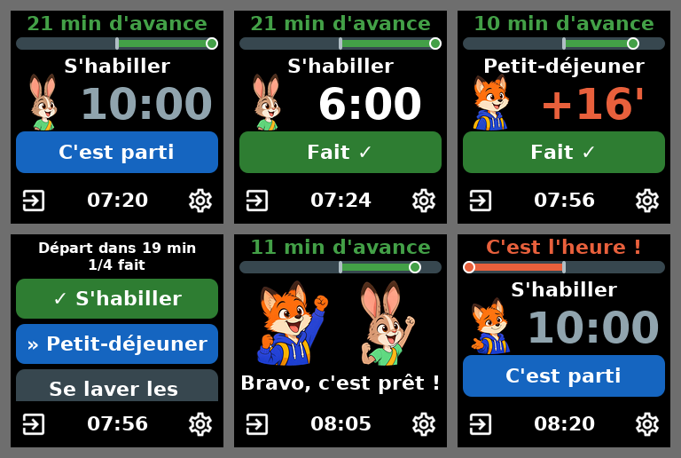

# App Home pour la T-Watch 2020

Routine du jour au poignet : étapes à cocher, compte à rebours, renard et lapin, synchronisation
avec la centrale ESP32-C6. Comme l'app Slovingo, elle se greffe sur le firmware
[T-Watch-2020](https://github.com/lstux/T-Watch-2020) sans le modifier.

**Statut : compilée en CI (v1, v2, v3) ; première version essayée sur une T-Watch 2020, écran « maintenant » pas encore.**



Aperçu rendu sur ordinateur avec LVGL 7.11 (routine fictive).

## Installer depuis le navigateur

Sur un ordinateur avec Chrome ou Edge : <https://lstux.github.io/HomePlanner/flash/watch/>. Faire la sauvegarde
ci-dessous avant la première fois, et laisser « Erase device » décochée.

Le site compile l'app avec le fork `lstux/T-Watch-2020` ; après un changement dans le fork seul, relancer
le workflow « Deploy PWA to GitHub Pages ».

## Installer en ligne de commande

```bash
pip install platformio
git clone https://github.com/lstux/T-Watch-2020.git
git clone https://github.com/lstux/HomePlanner.git
HomePlanner/platform/twatch/install.sh T-Watch-2020
cd T-Watch-2020
pio run -e t-watch2020-v1 -t upload     # remplace v1 par v2 ou v3 selon la montre
```

Sauvegarde conseillée avant le premier flash :

```bash
python ~/.platformio/packages/tool-esptoolpy/esptool.py --port <PORT> --baud 921600 read_flash 0 0x1000000 sauvegarde-twatch.bin
```

## Régler

1. Réglages Wi-Fi de la montre, et heure à jour (synchronisation NTP).
2. App **home** → roue dentée : adresse de la centrale (`http://homeplanner.local`, ou l'adresse IP si le nom
   ne répond pas) et code affiché sur son écran.
3. Flèche de retour : enregistre et synchronise.

Ou préparer `data/homeplanner.json` d'après `conf/homeplanner.json.example`, puis
`pio run -e t-watch2020-v1 -t uploadfs`. Attention : `uploadfs` réécrit **toute** la mémoire de la montre.

## Utiliser

L'écran principal dit à l'enfant, sans rien faire défiler :

- **en avance ou en retard** (texte et jauge : au milieu « pile poil », à droite l'avance, à gauche le retard, ±15 min) ;
- **l'étape en cours**, son compte à rebours en gros (`+1:30` quand il est dépassé) et la mascotte ;
- **un seul gros bouton** : « C'est parti » lance le minuteur, « Fait ✓ » valide et passe à la suivante. Deux
  appuis rapprochés ne valident qu'une étape.
- En bas : quitter, l'heure, les réglages. Quand tout est fait, le renard et le lapin fêtent ça.

En faisant glisser vers le haut : le temps avant le départ, toutes les étapes (toucher pour cocher ou décocher,
appui long pour « je fais celle-là »), le changement de routine ou d'enfant et « Synchroniser ».

La montre **reste sur Home** quand l'écran s'éteint (réglage « block maintile » activé tant que l'app est
ouverte, puis remis comme avant). Au réveil, elle revient sur l'écran principal et se resynchronise (au plus
une fois par minute). Elle garde réglages et coches pour fonctionner sans la maison ; elle ne modifie jamais
les réglages.

## Développement

`hp_core` (routines, marques, synchronisation) ne dépend pas du matériel :

```bash
g++ -std=c++11 -I<dossier de ArduinoJson.h 6.21> -Ihomeplanner tests/core_tests.cpp homeplanner/hp_core.cpp -o core_tests && ./core_tests
python3 tools/gen_assets.py   # regénère polices et images
```
